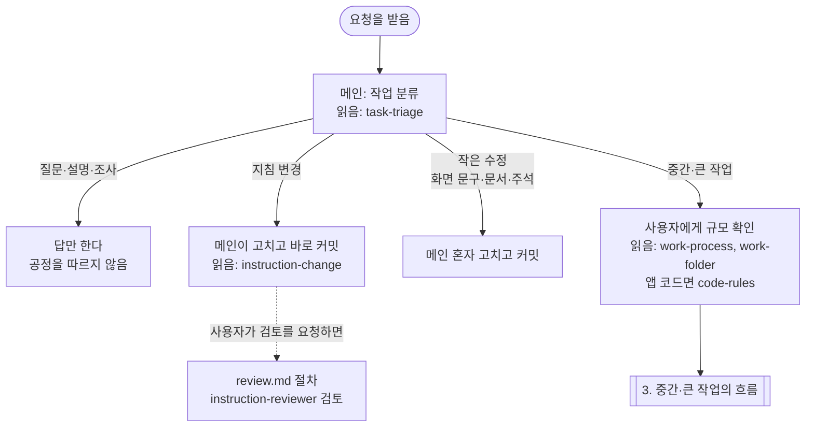
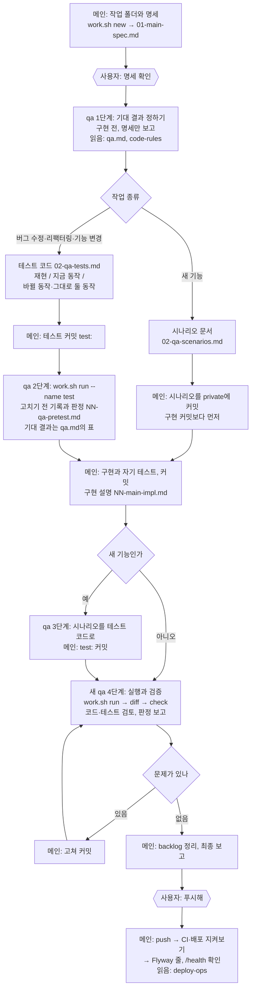
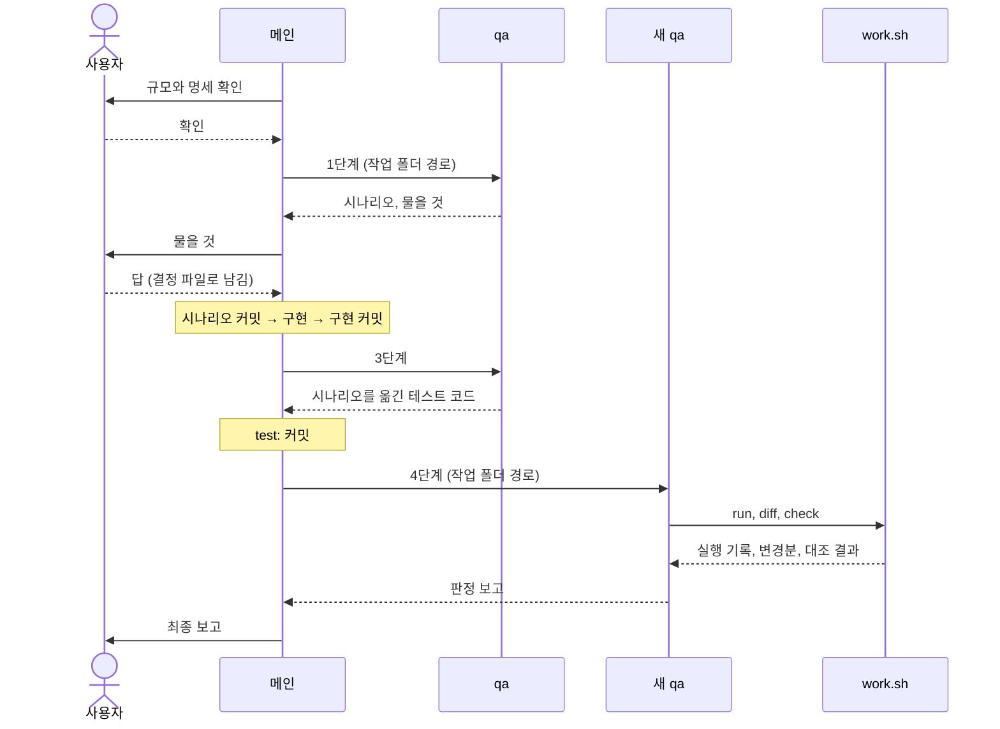
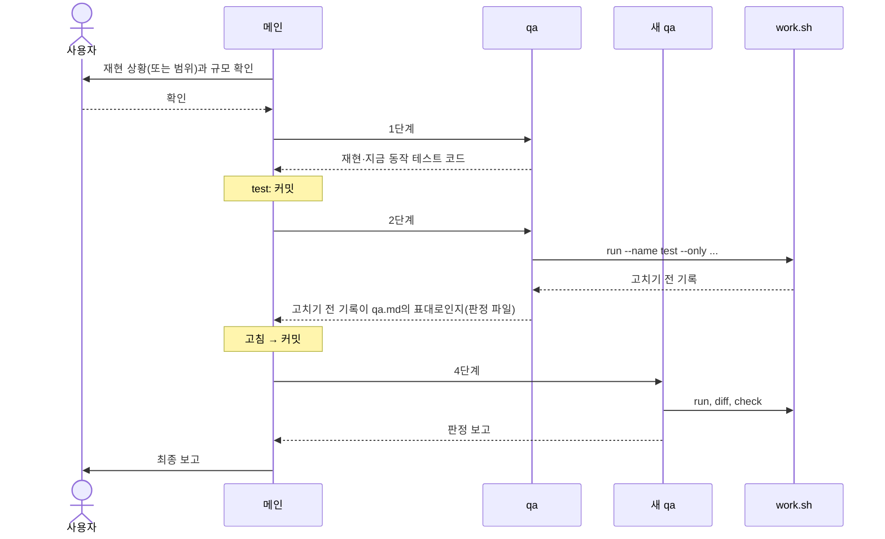

# Claude 작업 공정 설명서

Claude Code가 이 저장소에서 일하는 순서, 각 에이전트가 하는 일, 단계마다 읽는 지침을 정리한 문서다. 규칙의 원본은 `.claude/`(`CLAUDE.md`, `agents/`, `skills/`)이고, 이 문서는 그것을 한눈에 보려고 풀어 쓴 것이다. 지침이 바뀌면 함께 고친다.

흐름도는 Mermaid로 그렸다. GitHub에서 열면 그림으로 보이고, VS Code 미리보기에서는 "Markdown Preview Mermaid Support" 확장이 있어야 그림으로 보인다.

## 1. 등장하는 쪽

| 누구 | 언제 | 읽는 지침 | 하지 않는 일 |
|---|---|---|---|
| 메인 세션 | 늘 | `CLAUDE.md`(늘), 상황마다 아래 스킬 | 공식 실행 기록을 만들지 않는다 |
| `qa` 에이전트 | 중간 규모 이상 작업의 단계마다 | `qa.md`, `code-rules`(미리 받음), `CLAUDE.md` | 운영 코드·설정 수정, 커밋, 운영 접속 |
| `instruction-reviewer` | 지침 변경의 검토를 사용자가 요청할 때만 | `instruction-reviewer.md` | 파일 수정, 명령 실행 |

메인 세션이 상황마다 읽는 스킬:

| 스킬 | 언제 읽나 |
|---|---|
| `task-triage` | 고치는 작업을 시작하거나 이어서 할 때 맨 먼저 |
| `instruction-change` | 지침(`.claude/`)을 바꿀 때. 검토를 요청받으면 같은 폴더의 `review.md`도 |
| `work-process`, `work-folder` | 중간·큰 작업일 때 |
| `code-rules` | 앱 코드(`apps/`)나 운영 설정을 바꿀 때 |
| `deploy-ops` | "푸시해", 재배포·롤백, 운영 장애, 스토어 빌드 |

## 2. 시작: 작업 분류

- 작업 종류: 새 기능, 버그 수정, 리팩터링(동작은 그대로), 기능 변경(이미 있는 기능의 동작을 일부러 바꿈).
- 중간: 백엔드·웹·모바일 동작 코드, LLM 프롬프트·스키마·모델, DB 스키마, API, 운영 설정, 의존성, 검사 도구, Claude 설정 중 하나라도 바뀐다.
- 큰 작업: 여러 화면에 걸친 기능, 큰 리팩터링. 작은 기능으로 나눠 기능마다 아래 흐름을 한 바퀴씩 돈다(부모 폴더 아래 자식 폴더).

## 3. 중간·큰 작업의 흐름

- 1단계에서 qa가 명세가 모호하다고 물으면, 메인이 사용자에게 묻고 답을 결정 파일(`NN-main-decision.md`)로 남긴다.
- 새 기능은 qa가 시나리오를 쓰는 동안 메인이 구현을 시작해도 된다(qa는 작업 폴더에만 쓴다).
- 버그 수정·리팩터링·기능 변경은 "고치기 전 기록"이 남을 때까지 메인이 코드를 고치지 않는다.
- 기능 변경(이미 있는 기능의 동작을 일부러 바꾸는 일)은 명세에 바뀌는 동작, 그대로여야 할 동작, 그 때문에 고칠 기존 테스트를 적는다.
- 버그 수정, 리팩터링, 기능 변경에서 qa가 무엇을 테스트로 쓰고 고치기 전 기록에서 무엇이 나와야 하는지는 `.claude/agents/qa.md`의 "기존 코드 흐름의 테스트와 기대 결과" 표 한 곳에 있다.
- 고침과 검증을 같은 문제로 두 번 돌아도 풀리지 않으면 멈추고 사용자에게 보고한다. 메인이 qa 지적에 동의하지 않으면 혼자 넘기지 않고 사용자에게 묻는다.
- 4단계는 처음 검증이든 다시 검증이든 늘 새 qa로 부른다. 앞 단계를 이어 쓰면 qa의 맥락이 크게 쌓이고, 새 qa도 작업 폴더의 파일만으로 앞 단계를 이어받는다(2026-10-31 시범 두 번으로 정함).

## 4. 에이전트가 불리는 순서

새 기능:

버그 수정·리팩터링·기능 변경:

## 5. 단계별 상세

| 순서 | 누가 | 하는 일 | 읽는 지침 | 남기는 파일 | 커밋 |
|---|---|---|---|---|---|
| 1 | 메인 | 분류, 규모 확인 | `task-triage` | — | — |
| 2 | 메인 | 작업 폴더, 명세 | `work-process`, `work-folder`, (`code-rules`) | `01-main-spec.md` | 비공개(사용자 확인 뒤) |
| 3 | qa | 기대 결과 정하기 | `qa.md`, `code-rules` | `02-qa-scenarios.md` 또는 `02-qa-tests.md`와 테스트 코드, 겨냥 회귀 케이스 | 메인이 커밋 |
| 4 | 메인 | 사용자 결정 기록 | `work-folder` | `NN-main-decision.md` | 비공개 |
| 5 | qa | (버그·리팩터링·기능 변경) 고치기 전 실행과 판정 | `qa.md` | `NN-runner-test/`, `NN-qa-pretest.md` | 메인이 비공개 커밋 |
| 6 | 메인 | 구현 | `work-process`, `code-rules` | 코드, `NN-main-impl.md`(qa는 읽지 않음) | 공개, 비공개 |
| 7 | qa | (새 기능) 시나리오를 테스트로 | `qa.md` | 테스트 코드, `NN-qa-tests.md` | 메인이 `test:` 커밋 |
| 8 | 새 qa | 실행, 대조, 검토, 판정 | `qa.md`, `code-rules` | `NN-runner-*/`, `NN-main-diff-*.txt`, `NN-qa-verify.md` | 메인이 비공개 커밋 |
| 9 | 메인 | 고침 → 8로 | `work-process` | 코드, `NN-main-impl.md` | 공개, 비공개 |
| 10 | 메인 | backlog, 최종 보고 | — | `private/backlog.md` | 비공개 |
| 11 | 메인 | push와 배포 확인 | `deploy-ops` | — | push(사용자가 요청할 때만) |

qa의 테스트는 이름으로 가린다: 백엔드는 `...SpecTest`, 채점 규칙은 `[spec] ...`, 검사 스크립트는 `...spec.test.sh`, 웹은 `...spec.test.tsx`. 메인은 이 테스트를 고치지 않는다. 예외로 구현 때문에 바뀐 이름·import·패키지 경로를 따라가는 수정만 구현 커밋에서 하고, 4단계 qa가 그 변경이 그것뿐인지 본다.

## 6. 늘 돌아가는 도구

| 도구 | 하는 일 |
|---|---|
| 훅(`.claude/hooks/writeloop_guard.py`) | 공유된 마이그레이션 수정, 자동 DDL 설정, 엔티티를 바꾸고 마이그레이션을 빠뜨린 경우를 막는다 |
| 권한 설정(`.claude/settings.json`) | push는 승인을 받고, 비밀 파일은 읽지 못한다 |
| `scripts/dev/work.sh` | `new`(작업 폴더), `next`(다음 번호), `diff`(변경분), `status`(진행 상태), `run`(바뀐 경로로 검사를 골라 실행하고 기록), `check`(기록 대조) |
| `scripts/dev/ensure-docker.sh` | Docker가 꺼져 있으면 켠다. 실행 도구와 확인 스크립트가 알아서 부른다 |
| CI(`.github/workflows/ci.yml`) | push 뒤 테스트(실제 DB 통합 테스트 포함), 빌드, 마이그레이션 확인, 문법 검사를 돌리고, 모두 통과해야 운영에 배포한다. 마지막 배포 뒤로 개발 도구·채점 규칙·모바일·문서만 바뀌었으면 배포는 건너뛴다 |

## 7. 사용자에게 묻는 때

- 규모와 명세를 확인할 때
- qa가 명세가 모호하다고 할 때, 구현 중에 명세 문제를 찾았을 때
- qa의 테스트가 틀렸다고 볼 때, qa의 지적에 동의하지 않을 때
- 테스트를 고쳐야 할 때, 사용자와 정한 내용을 바꿔야 할 때
- OpenAI 비용이 드는 실행(LLM 회귀)을 할 때: 요청 수를 알리고 승인받는다
- push할 때: 사용자가 "푸시해"라고 할 때만 한다
